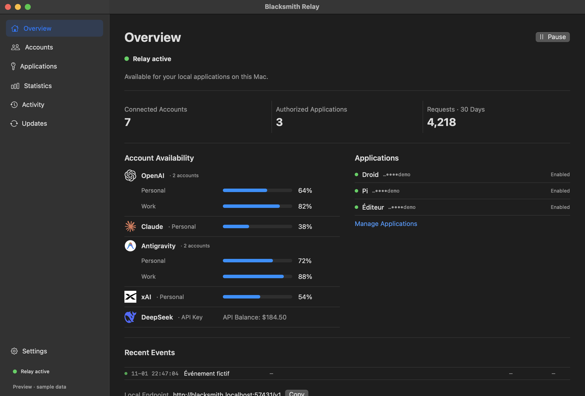
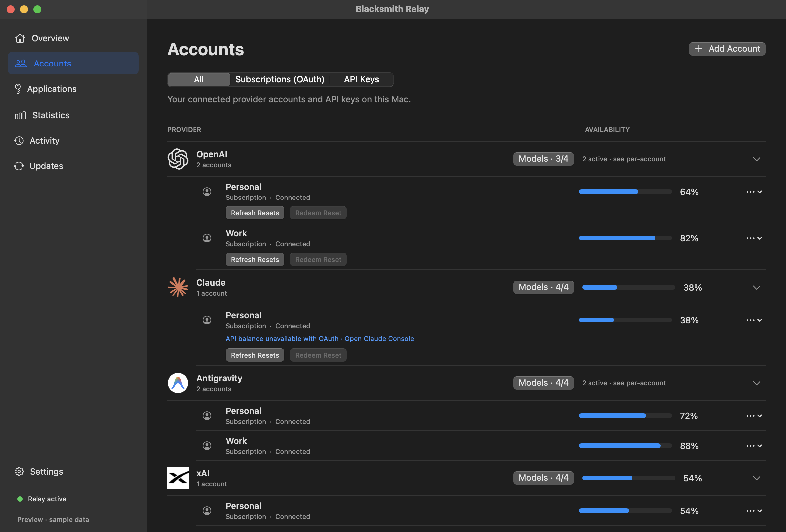
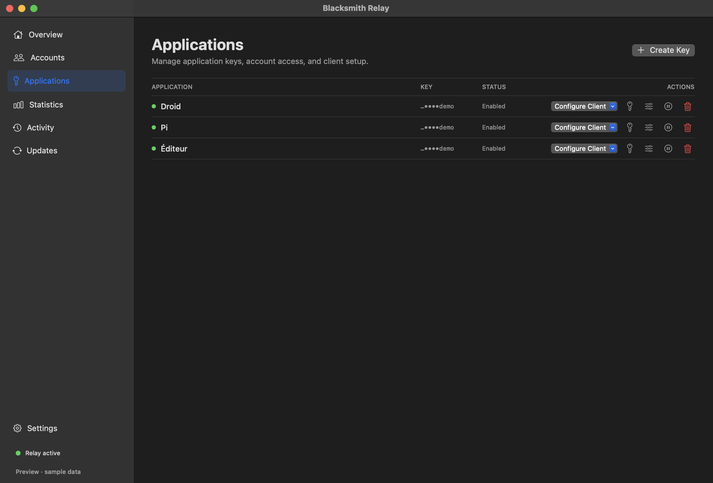
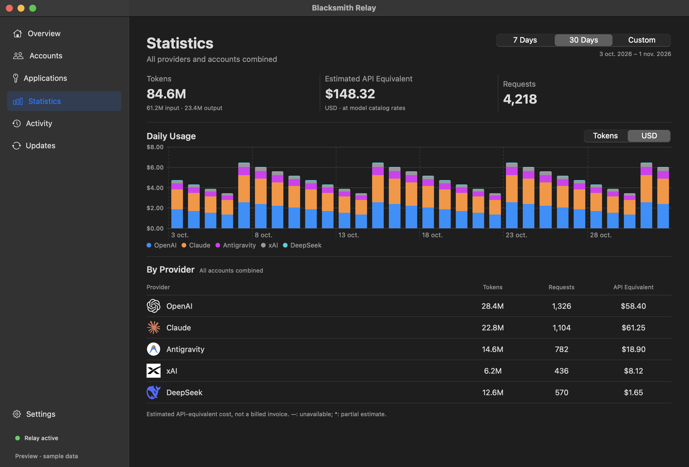

# Blacksmith Relay

**Blacksmith Relay** is a native macOS application and menu-bar daemon that connects local coding agents (**Codex**, **Claude Code**, **Pi**, and any OpenAI-compatible client such as **OpenRouter**-style tools) to your AI provider subscriptions and API accounts (**OpenAI**, **Claude**, **Antigravity / Gemini**, **xAI / Grok**, **DeepSeek**) through a single unified local endpoint.

---

## Why Blacksmith Relay?

- **One local endpoint for every provider**: Exposes `/v1/responses`, `/v1/messages`, and `/v1/chat/completions` locally on `http://127.0.0.1:57431/v1`, translating tool schemas, custom freeform `apply_patch` grammars, and streaming events across providers.
- **Native multi-model support in Codex**: Switch between OpenAI, Claude, Gemini, Grok, and DeepSeek models—complete with per-model reasoning effort levels and service tiers—directly inside the Codex app or CLI.
- **Authenticated multi-turn replay**: Preserves signed reasoning blocks and tool-call signatures across turns (`AES-256-GCM` sealed state) while safely stripping provider-specific state when switching models mid-thread.
- **Quota-aware automatic account switching**: Monitor remaining subscription quotas, reset credits, and API balances across multiple accounts, with automatic switching before an account hits its limit.
- **Scoped application keys & model visibility**: Grant each client application access only to the accounts you choose, hide legacy or unwanted models per provider, and inspect local token/USD usage analytics without logging prompts or secrets.

---

## Screenshots

### Overview & Live Availability

### Accounts, Quotas & Model Visibility

### Applications & Client Config Export

### Usage & API-Equivalent Cost Statistics

---

## Installation

1. Download the latest `.dmg` from [**Releases**](../../releases).
2. Open the disk image and drag **Blacksmith Relay.app** to `/Applications`.
3. Launch **Blacksmith Relay** (macOS 15+ on Apple Silicon `arm64`). The background relay service starts automatically on `http://127.0.0.1:57431/v1`.

---

## Integrating with Codex (3 Steps)

Setting up Codex takes less than a minute—no manual TOML editing required:

1. **Connect your provider accounts**
   Open the **Accounts** tab in Blacksmith Relay and add the accounts you want to use (OAuth sign-in or API key). You can optionally click **Models…** on any provider to toggle which models appear in your clients.
2. **Create an application key & pick the Codex guide**
   Open the **Applications** tab, click **Create Key**, name your application (e.g. `Codex`), choose **Harness configuration → Codex**, and check the accounts it is allowed to use. Click **Create & Open Setup Guide**. You can reopen the guide at any time with the **Setup Guide** button on the application's row.
3. **Choose your default models & save the files**
   In the Setup Guide, click **Export Configuration…**. In the export sheet:
   - Pick your **Primary model** (default primary model) and **Default subagent model** (default subagent model).
   - Select **New configuration** (or **Merge with existing config.toml** to merge into your existing `~/.codex/config.toml` without losing your personal settings, MCP servers, or project rules).
   - Click **Save…** and save both exported files (`config.toml` and `blacksmith-models.json`) into `~/.codex/` (or your custom `$CODEX_HOME`).

Restart Codex and start a **new chat**—all your enabled models and reasoning effort levels will be available directly in the Codex model selector.
